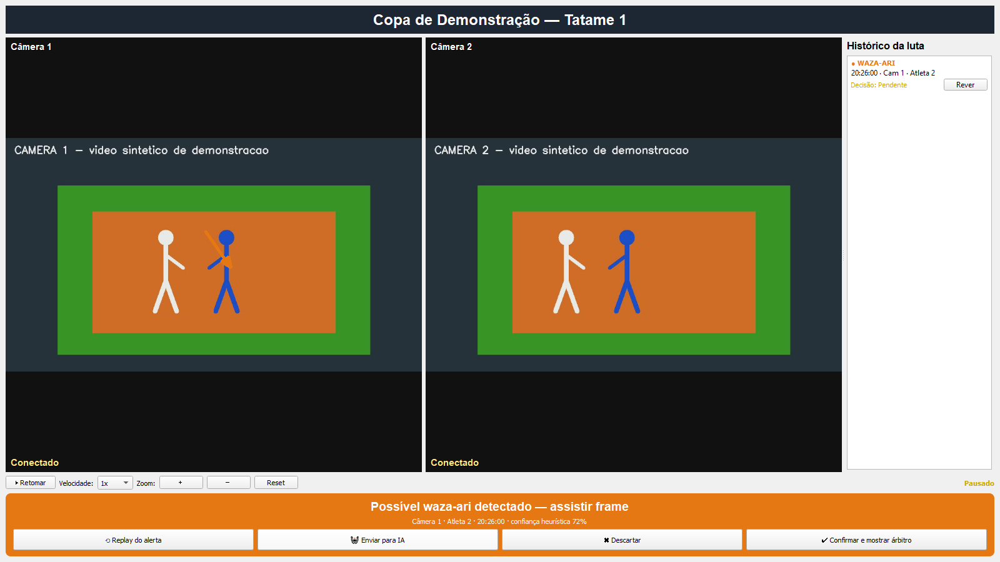
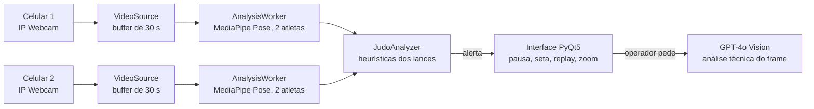
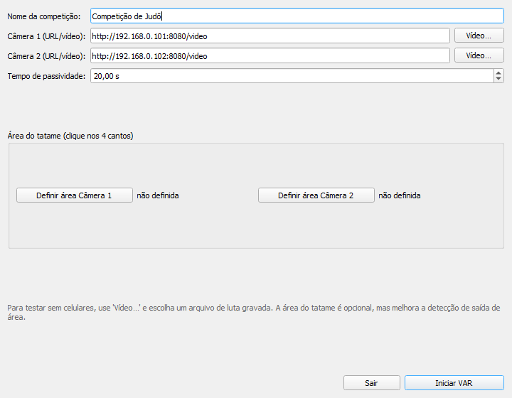

<div align="center">

# VAR Judô

**Árbitro de vídeo assistido para competições de judô: dois feeds de câmera, replay instantâneo, detecção automática de lances com visão computacional e análise técnica com GPT-4o Vision.**


<br>



<sub>Interface real do sistema rodando com vídeo sintético de demonstração.</sub>

</div>

## O problema

Em competições locais de judô não existe VAR: a arbitragem decide em tempo real, sem replay, e lances rápidos como um yoko-guruma ou uma saída de área passam despercebidos. Este software transforma **um notebook comum e dois celulares** em um sistema de revisão de vídeo para um tatame.

## Como funciona



1. Cada câmera roda em uma thread própria e mantém os **últimos 30 segundos** em um buffer circular.
2. O **MediaPipe PoseLandmarker** rastreia os dois atletas ao mesmo tempo, sem GPU.
3. Heurísticas analisam ângulo do tronco, altura dos ombros, velocidade angular, posição das mãos e dos pés.
4. Ao detectar um lance suspeito, o vídeo **pausa**, uma seta aponta o atleta e um alerta colorido aparece.
5. O operador revê em câmera lenta e com zoom e, se quiser, envia o frame ao **GPT-4o Vision** para uma segunda opinião técnica.

> **A decisão é sempre humana.** A detecção automática é uma heurística para chamar a atenção do operador ("olhe este frame"), não uma decisão arbitral.

## Funcionalidades

- **Dois feeds lado a lado** a partir de celulares (app IP Webcam) ou de arquivos de vídeo para teste.
- **Replay instantâneo** dos últimos 30 s, com velocidade 0.25x, 0.5x e 1x.
- **Zoom digital** por botões ou roda do mouse, com arraste quando ampliado.
- **Alertas coloridos por tipo**: vermelho (ippon), laranja (waza-ari, yoko-guruma) e amarelo (shidos).
- **Histórico da luta** com horário, tipo, decisão do operador e botão para rever cada alerta.
- **Área do tatame calibrável**: o operador clica nos 4 cantos para a detecção de saída de área.
- **Análise com IA sob demanda**: só envia o frame quando o operador pede, controlando o custo.

## Detecções automáticas

| Lance | Heurística (resumo) |
|---|---|
| Ippon | tronco > 45° da vertical + ombros próximos ao solo por > 2 s |
| Waza-ari | tronco entre 45° e 90° + região baixa por > 1 s |
| Yoko-guruma | alta velocidade angular do tronco + queda vertical |
| Shido passividade | ambos os atletas parados por mais de N s (configurável) |
| Shido saída de área | ambos os pés fora do polígono do tatame |
| Shido pegada ilegal | pulso abaixo do quadril por > 3 s |

Todos os limiares ficam em `var_judo/config.py` (classe `Limiares`) e devem ser calibrados com lutas gravadas antes do uso em competição.

## Screenshots

<table>
  <tr>
    <td width="50%" valign="top"><br><sub>Tela de configuração da sessão</sub></td>
    <td width="50%" valign="top"><br><sub>Alerta de possível waza-ari, com histórico da luta</sub></td>
  </tr>
</table>

## Requisitos

- Windows com Python 3.12 ou superior (validado no 3.14).
- Notebook dedicado, só CPU.
- Dois celulares com o app **IP Webcam** (ou similar) na mesma rede Wi-Fi.
- Chave da OpenAI na variável `OPENAI_API_KEY`, para a análise com IA.

## Instalação

1. Execute **`setup_env.bat`**. Ele cria o `.venv`, instala as dependências e baixa o modelo de pose `pose_landmarker_lite.task`.
2. Defina a chave da OpenAI (uma vez por usuário) e reabra o terminal:
   ```
   setx OPENAI_API_KEY "sua-chave-aqui"
   ```
3. Execute **`run.bat`** (ou `.venv\Scripts\python -m var_judo.main`).

Na tela de configuração, informe o nome da competição, as URLs das câmeras (ex.: `http://192.168.0.101:8080/video`) ou escolha um vídeo gravado, ajuste o tempo de passividade e, opcionalmente, marque os 4 cantos do tatame.

## Estrutura

```
var_judo/
  main.py            entrypoint (configuração -> janela principal)
  config.py          AppConfig + limiares de calibração
  alert.py           tipos de alerta, cores e mensagens
  video_source.py    captura IP/arquivo + buffer circular de 30 s
  pose_detector.py   MediaPipe PoseLandmarker (2 atletas)
  judo_analyzer.py   heurísticas dos 6 lances
  analysis_worker.py pose + heurísticas fora da thread da interface
  gpt_vision.py      integração com o GPT-4o Vision
  setup_window.py    tela de configuração + marcação do tatame
  main_window.py     orquestra tudo
  widgets/           vídeo, painel de alerta e histórico
```

## Limitações conhecidas

- A pontuação detectada é **heurística**, não oficial: sempre confira o vídeo.
- O rastreamento por proximidade pode **trocar a identidade** dos atletas quando eles se cruzam.
- O desempenho depende da CPU. Se ficar lento, aumente `pose_a_cada_n` em `config.py`.
- Cada clique em **"Enviar para IA"** é uma chamada paga à API da OpenAI.

---

<div align="center">
<sub>Desenvolvido por <a href="https://garrastudios.online">Garra Studios</a> · Precisa de um sistema com visão computacional ou IA? <a href="https://garrastudios.online/#contato">Vamos conversar</a>.</sub>
</div>
